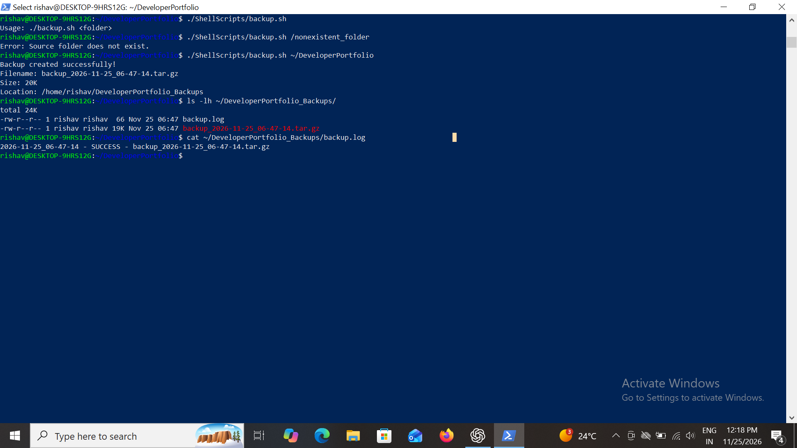

# DeveloperPortfolio

## Beginner Developer Ecosystem portfolio 

**Author:** Rishav Chandra Prasad

**Roll:** 2601730356

## About this repository
this repository demonstrates the technical skills developed throughout the semester as part of the capstone project.

## Repository Structure

- Linux/ - system documentation and Linux commands
- ShellScripts/ - Bash scripting and automation 
- API/ - REST API interaction and JSON documentaion
- Portfolio/ - Resume and career learning roadmap
- Screenshots/ - Supporting evidence

## Professional Profiles

- GitHub: https://github.com/RishavChandra98
- Linkedin: https://www.linkedin.com/in/rishav-chandra-prasad-b105163b6
## Supporting Screenshots

### Shell Script Backup Demonstration

### Professional Profiles

- [GitHub Profile](Screenshots/github_profile.png)
- [LinkedIn Profile](Screenshots/linkedin_profile.png)
- [LinkedIn Education](Screenshots/linkedin_education.png)
- [LinkedIn Projects](Screenshots/linkedin_projects.png)
